<p align="center">
  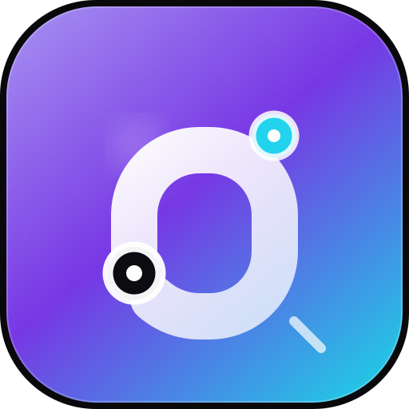
</p>

<h1 align="center">SynapsePipe</h1>

<p align="center">
  <strong>Next-gen Local-first AIGC Workbench &amp; Creative Pipeline</strong><br/>
  <sub>Idea → Prompt → Assets. A creative pipeline that stays legible, reproducible, and entirely on your own machine.</sub>
</p>

<p align="center">
  <a href="https://nextjs.org/"></a>
  <a href="https://react.dev/"></a>
  <a href="https://www.typescriptlang.org/"></a>
  <a href="https://tailwindcss.com/"></a>
  <a href="https://orm.drizzle.team/"></a>
  <a href="https://www.sqlite.org/"></a>
  <a href="./LICENSE"></a>
  <a href="./CONTRIBUTING.md"></a>
</p>

<p align="center">
  <a href="./README.zh-CN.md">中文文档</a> ·
  <a href="#-quick-start">Quick start</a> ·
  <a href="#-architecture">Architecture</a> ·
  <a href="#-features">Features</a> ·
  <a href="#-docker">Docker</a> ·
  <a href="#license-policy">License policy</a> ·
  <a href="#acknowledgements">Credits</a>
</p>

---

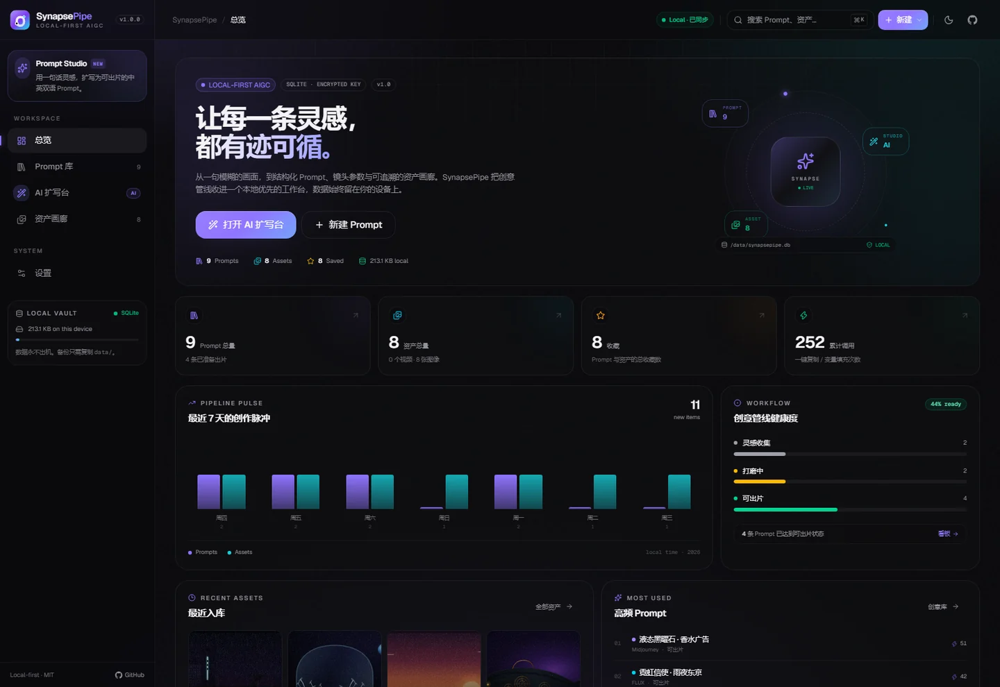

## Why SynapsePipe?

Most AIGC workflows leak. A prompt lives in a chat, the seed lives in a screenshot, and the final asset lives in a downloads folder. SynapsePipe closes that loop in one local-first workspace:

- **Structured by default.** A prompt is not a blob of text — it carries bilingual copy, style, camera language, target model, aspect ratio, negative prompt, reusable `[variables]`, and director notes.
- **Reproducible by design.** Every asset stores its Prompt snapshot, Seed, model, generation params, category, and tags, so you can rebuild the shot instead of guessing.
- **Local-first, not cloud-first.** SQLite and uploaded media live under `data/`. The API key is encrypted at rest. There is no account, no telemetry, and no hosted backend.
- **Quietly fast.** Server Components + Server Actions, optimistic UI, debounced search, skeleton-matched loading states, blurred media placeholders, and Framer Motion micro-interactions.

> Built for independent creators who want the leverage of an AI studio without giving up ownership of their creative memory.

## Features

<table>
  <tr>
    <td width="50%" valign="top">
      <h3>◈ Structured Prompt Library</h3>
      <p>List and board views over the same creative pipeline. Filter by style, target model, camera language, workflow stage, favorites, and tags. One-click quick copy, bilingual versions, and a variable injector for prompts like <code>[subject] in [scene]</code>.</p>
    </td>
    <td width="50%" valign="top">
      <h3>✦ AI Prompt Studio</h3>
      <p>Turn one rough idea into a production-grade prompt with Chinese + English output, negative prompt, shot parameters, reusable variables, and director notes. Works with any OpenAI-compatible provider — DeepSeek, OpenAI, OpenRouter, Ollama, LM Studio, and more.</p>
    </td>
  </tr>
  <tr>
    <td width="50%" valign="top">
      <h3>▣ Traceable Asset Gallery</h3>
      <p>Upload local images/video or reference external URLs. Each asset keeps its Prompt snapshot, Seed, model, params, category, and tags. Favorite, filter, inspect, download/re-export, or copy the whole generation recipe.</p>
    </td>
    <td width="50%" valign="top">
      <h3>⌘ Designed like a tool, not a demo</h3>
      <p>Dark-first neutral palette, restrained micro-borders, frosted glass, compact typography, shortcut-driven command palette, dark/light themes, responsive navigation, and Sonner toasts. Every loading surface has a matching skeleton.</p>
    </td>
  </tr>
  <tr>
    <td width="50%" valign="top">
      <h3>⛁ Own the data path</h3>
      <p>A single SQLite file at <code>data/synapsepipe.db</code>, media at <code>data/uploads/</code>, and an encrypted secret at <code>data/.secret</code>. Copy the folder to back up everything. Export a metadata-only JSON from Settings.</p>
    </td>
    <td width="50%" valign="top">
      <h3>⬡ One process, zero extra services</h3>
      <p>All backend logic runs through Next.js Server Actions and Route Handlers. No separate Python/Go/Express service to deploy, and a multi-stage Docker image for reproducible self-hosting.</p>
    </td>
  </tr>
</table>

## Screenshots

| Prompt library | AI Prompt Studio |
| --- | --- |
| 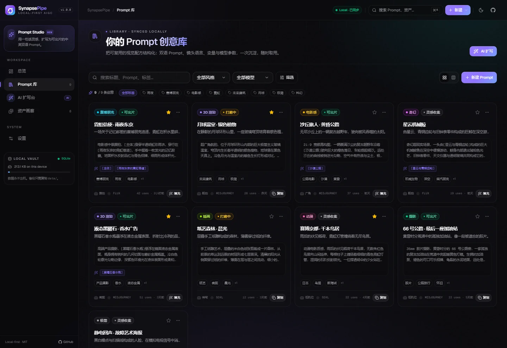 | 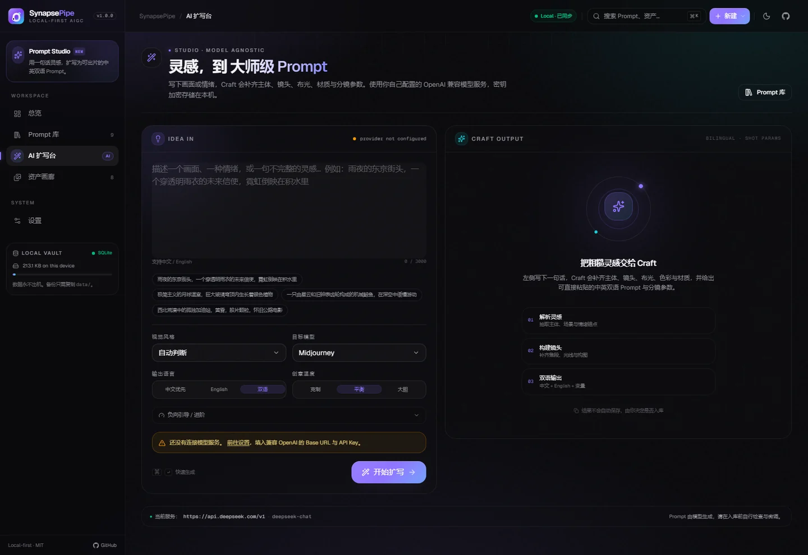 |

| Asset gallery | Settings |
| --- | --- |
| 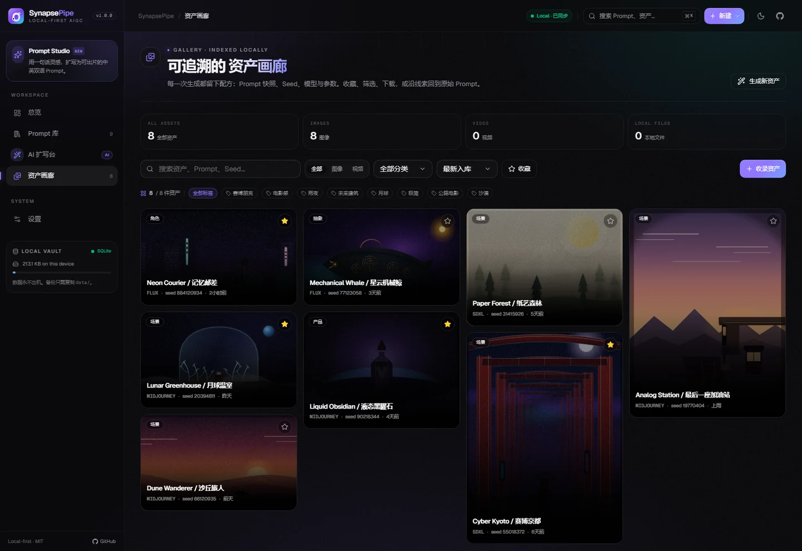 | 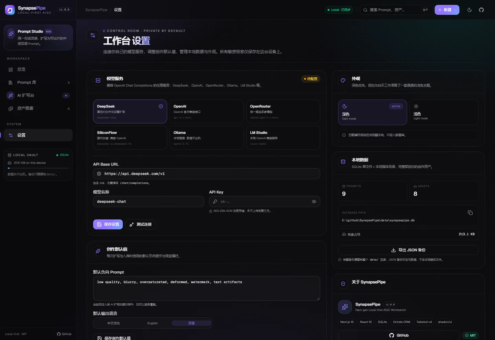 |

| Command palette | Prompt board |
| --- | --- |
| 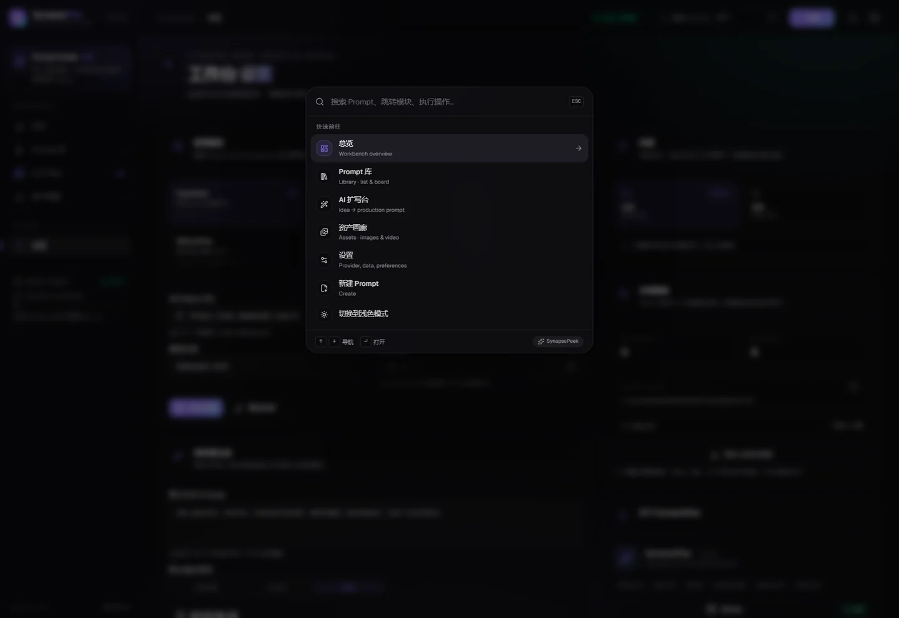 | 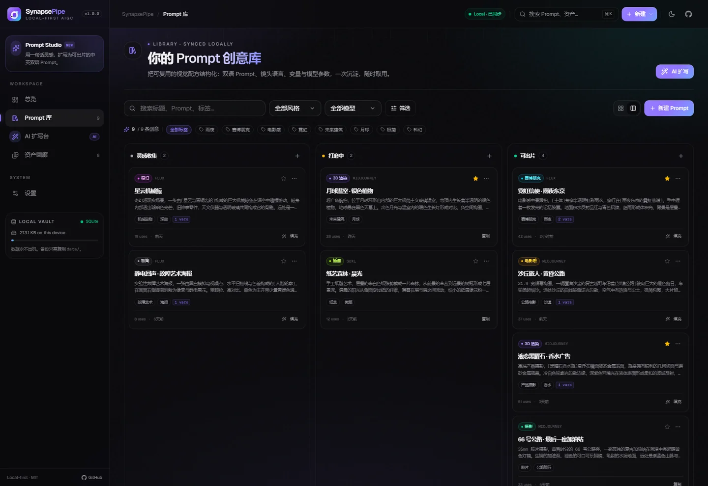 |

<p align="center">
  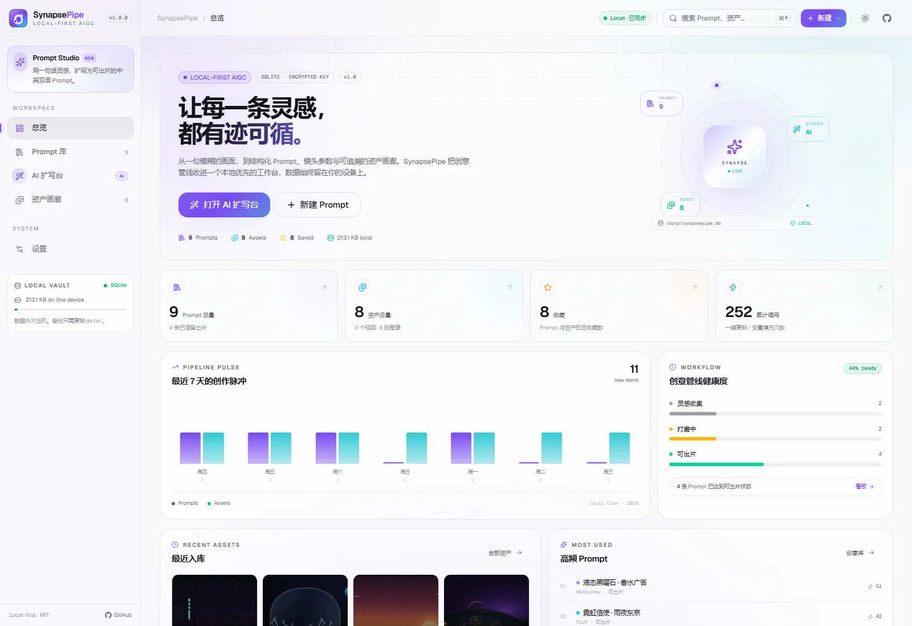
  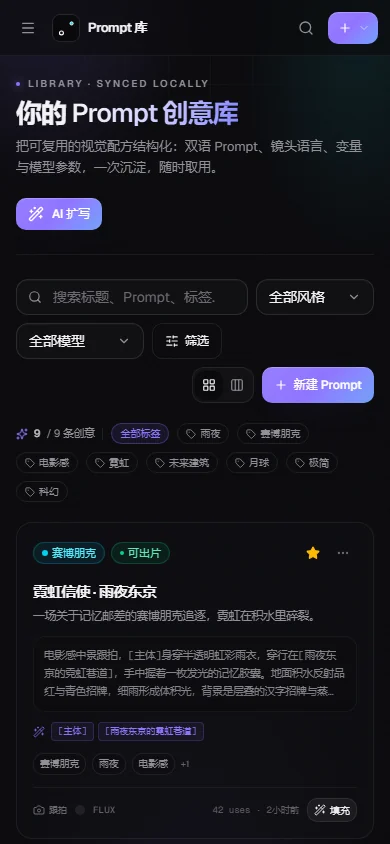
</p>

## Quick Start

**Requirements:** Node.js **20.11+** (22 LTS recommended) and npm 10+.

```bash
git clone https://github.com/FanDuck/SynapsePipe.git
cd SynapsePipe
npm install
cp .env.example .env.local   # optional — every value has a local-first default
npm run dev
```

Open **http://localhost:3000**.

On first boot SynapsePipe creates `data/synapsepipe.db`, applies the schema, and seeds a curated demo library (9 prompts + 8 offline demo assets). Delete `data/` to reset, or set `SYNAPSE_DISABLE_DEMO_SEED=1` for a clean slate.

### Connect a model provider

1. Open **Settings → Model service**.
2. Pick a preset or paste any OpenAI-compatible **Base URL** and **Model**.
3. Add your **API Key** (not required for local Ollama/LM Studio) and click **Save**.
4. Click **Test connection** — then go to **AI Prompt Studio** and turn an idea into a prompt.

| Provider | Base URL | Example model |
| --- | --- | --- |
| DeepSeek | `https://api.deepseek.com/v1` | `deepseek-chat` |
| OpenAI | `https://api.openai.com/v1` | `gpt-4.1-mini` |
| OpenRouter | `https://openrouter.ai/api/v1` | `openai/gpt-4.1-mini` |
| SiliconFlow | `https://api.siliconflow.cn/v1` | `deepseek-ai/DeepSeek-V3` |
| Ollama | `http://localhost:11434/v1` | `qwen2.5:7b` |
| LM Studio | `http://localhost:1234/v1` | your loaded model |

> SynapsePipe calls the `/chat/completions` endpoint. JSON mode is used when available and gracefully falls back for providers that do not support it.

## Docker

The image is multi-stage, runs the Next.js standalone server as a non-root user, and keeps all state in a named volume.

```bash
docker compose up -d
# → http://localhost:3000
```

Useful commands:

```bash
docker compose logs -f
docker compose down            # keep data
docker compose down -v         # remove data volume (destructive)
```

Optional overrides (`.env` next to `docker-compose.yml`):

```dotenv
SYNAPSEPIPE_PORT=3000
SYNAPSE_SECRET=replace-with-a-long-random-string
SYNAPSE_DISABLE_DEMO_SEED=0
NEXT_PUBLIC_APP_URL=http://localhost:3000
```

The SQLite database and uploads persist in the `synapsepipe_data` volume. Back up the volume, or copy `data/` from a bind-mounted setup.

## Architecture

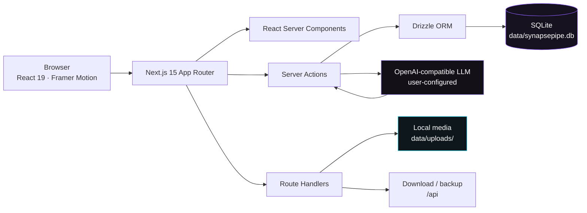

No second backend process. The browser talks to one Next.js app; server code owns SQLite, uploads, encryption, and provider calls.

### Data model

| Table | Purpose | Notable fields |
| --- | --- | --- |
| `prompts` | Structured creative formulas | `prompt_zh`, `prompt_en`, `negative_prompt`, `style`, `camera`, `model`, `aspect_ratio`, `stage`, `tags[]`, `variables[]`, `shot_params`, `is_favorite`, `usage_count` |
| `assets` | Generated/referenced media | `type`, `source`, `url`, `storage_key`, `prompt_id → prompts`, `prompt_snapshot`, `seed`, `model`, `category`, `tags[]`, `params`, `is_favorite` |
| `settings` | Single-row local configuration | `llm_base_url`, `llm_api_key_cipher`, `llm_model`, `default_negative_prompt`, `default_language` |

Drizzle schema lives in [`src/lib/db/schema.ts`](./src/lib/db/schema.ts). The application bootstraps the SQLite schema and seed data idempotently in [`src/lib/db/index.ts`](./src/lib/db/index.ts).

## Project Structure

```text
SynapsePipe/
├─ src/
│  ├─ app/
│  │  ├─ (workspace)/           # Shared app shell: dashboard, prompts, studio, gallery, settings
│  │  ├─ api/                   # Health, backup, local uploads, asset download
│  │  ├─ globals.css            # Dark-first design tokens, utilities, motion primitives
│  │  ├─ layout.tsx             # Metadata, Geist fonts, providers
│  │  └─ manifest.ts            # PWA manifest
│  ├─ components/
│  │  ├─ ui/                    # shadcn/ui primitives (Radix + CVA)
│  │  ├─ layout/                # Sidebar, topbar, command palette, theme toggle
│  │  ├─ prompts/               # Prompt library, board, detail sheet, variable injector
│  │  ├─ generate/              # AI Prompt Studio
│  │  ├─ gallery/               # Asset gallery, upload, detail, progressive media
│  │  ├─ settings/              # Provider, data, appearance, about
│  │  ├─ dashboard/             # Overview, pipeline pulse, recent activity
│  │  └─ shared/                # Brand, headers, empty states, time, copy, tags
│  ├─ hooks/                    # Debounce and client utilities
│  └─ lib/
│     ├─ actions/               # Server Actions: prompts, assets, settings, AI
│     ├─ db/                    # Drizzle schema, singleton, queries, seed
│     ├─ ai.ts                  # OpenAI-compatible client + prompt director
│     ├─ crypto.ts              # AES-256-GCM secret handling
│     ├─ storage.ts             # Local media storage
│     ├─ validations.ts         # Zod contracts
│     └─ constants.ts           # Design taxonomy: styles, cameras, models
├─ public/
│  ├─ demo/                     # Offline demo AIGC artwork (SVG)
│  ├─ logo.svg
│  └─ og.png
├─ data/                        # Local runtime only (gitignored)
├─ docs/screenshots/
├─ THIRD_PARTY_NOTICES.md       # Dependency licenses and upstream credits
├─ CITATION.cff                 # Machine-readable citation metadata
├─ CONTRIBUTING.md
├─ SECURITY.md
├─ Dockerfile
├─ docker-compose.yml
├─ drizzle.config.ts
└─ .env.example
```

## Environment Variables

| Variable | Default | Description |
| --- | --- | --- |
| `SYNAPSE_DATA_DIR` | `./data` | Data root for SQLite + uploads |
| `SYNAPSE_DB_PATH` | `<data>/synapsepipe.db` | Optional explicit database path used by Drizzle CLI |
| `SYNAPSE_SECRET` | generated | Encryption material for the provider API key; generated as `data/.secret` when omitted |
| `SYNAPSE_LLM_BASE_URL` | `https://api.deepseek.com/v1` | Bootstrap provider URL (first launch only) |
| `SYNAPSE_LLM_API_KEY` | empty | Bootstrap key (first launch only; encrypted immediately) |
| `SYNAPSE_LLM_MODEL` | `deepseek-chat` | Bootstrap model (first launch only) |
| `SYNAPSE_DISABLE_DEMO_SEED` | `0` | Set `1` to skip the demo prompt/asset seed |
| `NEXT_PUBLIC_APP_URL` | `http://localhost:3000` | Metadata / Open Graph base URL |

## Scripts

| Script | Description |
| --- | --- |
| `npm run dev` | Next.js dev server with Turbopack |
| `npm run build` | Production build (standalone output) |
| `npm run start` | Start the production server |
| `npm run lint` | ESLint |
| `npm run typecheck` | `tsc --noEmit` |
| `npm run db:generate` | Generate Drizzle migrations from schema |
| `npm run db:studio` | Open Drizzle Studio |

## Security & Privacy

- **No account, no telemetry, no cloud sync.** The app is designed to run on `localhost`.
- API keys are encrypted with **AES-256-GCM** and a secret derived from `SYNAPSE_SECRET` or the generated `data/.secret`. The key never leaves the server except in the outbound provider request.
- Provider calls go directly from your machine to the base URL you configure.
- Uploaded files are validated by MIME type and extension (max 30 MB) and stored outside the public directory, served through a controlled route.
- **There is no built-in authentication.** Do not expose SynapsePipe directly to the public internet. Put it behind a reverse proxy with authentication, or keep it on a trusted LAN/VPN.
- Back up the entire `data/` directory. Losing `data/.secret` requires re-entering the API key.

See [SECURITY.md](./SECURITY.md) for responsible disclosure.

## Roadmap

- [x] Structured Prompt library with list + board views
- [x] Variable placeholders and bilingual Prompt copy
- [x] OpenAI-compatible AI expansion with encrypted settings
- [x] Local upload / URL asset gallery with Prompt + Seed provenance
- [x] Dark/light themes, command palette, responsive shell
- [x] Docker image + compose + JSON metadata backup
- [ ] Drag-and-drop board with keyboard-accessible lanes
- [ ] Prompt version history and diff view
- [ ] Full ZIP backup including uploads
- [ ] Video thumbnail extraction and timeline previews
- [ ] Optional multi-user auth adapter
- [ ] Import from JSON backup
- [ ] i18n locale switcher (English UI)

## Contributing

Contributions, ideas, and bug reports are welcome. Please read [CONTRIBUTING.md](./CONTRIBUTING.md) first. Before opening a PR:

```bash
npm run lint
npm run typecheck
npm run build
```

Use [Conventional Commits](https://www.conventionalcommits.org/) (`feat:`, `fix:`, `style:`, `docs:`, `chore:`). This project follows the [Contributor Covenant](./CODE_OF_CONDUCT.md).

<a id="license-policy"></a>

## License & Derivative Works Policy

### License

SynapsePipe is open source under the **[MIT License](./LICENSE)**.

**Copyright © 2026 FanDuck and SynapsePipe contributors.**

You are free to use, copy, modify, merge, publish, distribute, sublicense, and/or sell copies of the software, subject to the condition that the copyright notice and permission notice are included in all copies or substantial portions of the software. The software is provided **“as is”**, without warranty of any kind. The full controlling text is in [`LICENSE`](./LICENSE).

### Secondary creation, derivative development, repackaging & commercial use

We welcome forks, derivative projects, translations, integrations, and commercial deployments. If you modify, refactor, rebrand, repackage, redistribute, or host a derivative version of SynapsePipe, the following project requirements apply:

#### 1. Attribution & provenance

You **must** retain and display the original project identity in a **prominent location**:

- the **top of your README**, and
- an **About / Acknowledgements page in the product UI** (or an equivalent visible credits surface).

The attribution must include:

- the original project name **SynapsePipe**;
- the original repository URL **https://github.com/FanDuck/SynapsePipe**;
- the original author **FanDuck**;
- a statement that your version is a derivative work.

For hosted or SaaS deployments, add a visible **“Powered by SynapsePipe”** link in the product footer or About page.

Recommended copy-paste notice:

> **Based on SynapsePipe by FanDuck** — https://github.com/FanDuck/SynapsePipe
> Licensed under the MIT License. This is an independent derivative work and is not endorsed by or affiliated with the original author.

#### 2. License inheritance & notices

- Include the **complete original MIT License text** in every derivative distribution.
- Retain the **original copyright notice** (`Copyright © 2026 FanDuck and SynapsePipe contributors`).
- Clearly mark files and interfaces that you changed, and do not misrepresent the origin of unmodified code.
- If you add third-party code, assets, fonts, models, or datasets, verify their licenses and include the required notices and attribution.

#### 3. No endorsement, sponsorship, or commercial guarantee

- Do **not** state or imply that the original author, FanDuck, or the SynapsePipe project endorses, sponsors, certifies, or supports your derivative version.
- Do **not** use the SynapsePipe name or logo in a way that suggests your version is the official product.
- Do **not** present the original project as a commercial warranty, service-level guarantee, or security certification for your distribution.
- Make it clear that your derivative is independently maintained and provided under your own responsibility.

### Commercial use

Commercial use is permitted by the MIT License. Commercial derivative products are welcome, provided they comply with the attribution, license-inheritance, and no-endorsement requirements above. You are responsible for your own product claims, user agreements, privacy policy, security posture, and legal compliance.

### Scope & legal note

This policy records the SynapsePipe project's attribution, provenance, and identity expectations. It does **not** reduce, replace, or add conditions to the rights granted by the MIT License for the source code; where a legal conflict exists, the [MIT License](./LICENSE) controls the licensed code. The SynapsePipe name and logo identify the original project; no trademark registration or endorsement right is granted. If you are unsure whether a use is appropriate, open an issue or discussion before publishing.

<a id="acknowledgements"></a>

## Acknowledgements & Upstream Credits

SynapsePipe stands on the work of the open-source community. We gratefully acknowledge the projects, teams, and licenses that make this workbench possible.

| Upstream project | Role in SynapsePipe | License | Source |
| --- | --- | --- | --- |
| [Next.js](https://nextjs.org/) | App Router, RSC, Server Actions, Route Handlers | MIT | [GitHub](https://github.com/vercel/next.js) |
| [React](https://react.dev/) | UI runtime | MIT | [GitHub](https://github.com/facebook/react) |
| [TypeScript](https://www.typescriptlang.org/) | Type system and compiler | Apache-2.0 | [GitHub](https://github.com/microsoft/TypeScript) |
| [Tailwind CSS](https://tailwindcss.com/) | Utility-first styling and design tokens | MIT | [GitHub](https://github.com/tailwindlabs/tailwindcss) |
| [shadcn/ui](https://ui.shadcn.com/) | Component architecture and primitives | MIT | [GitHub](https://github.com/shadcn-ui/ui) |
| [Radix UI](https://www.radix-ui.com/) | Accessible headless primitives | MIT | [GitHub](https://github.com/radix-ui/primitives) |
| [Lucide](https://lucide.dev/) | Icon system | ISC | [GitHub](https://github.com/lucide-icons/lucide) |
| [SQLite](https://sqlite.org/) | Embedded relational database | Public Domain | [sqlite.org](https://sqlite.org/copyright.html) |
| [Drizzle ORM](https://orm.drizzle.team/) | Typed schema and query layer | Apache-2.0 | [GitHub](https://github.com/drizzle-team/drizzle-orm) |
| [better-sqlite3](https://github.com/WiseLibs/better-sqlite3) | Synchronous SQLite driver | MIT | [GitHub](https://github.com/WiseLibs/better-sqlite3) |
| [Framer Motion](https://www.framer.com/motion/) | Motion and interaction system | MIT | [GitHub](https://github.com/motiondivision/motion) |
| [Sonner](https://sonner.emilkowal.ski/) | Toast notifications | MIT | [GitHub](https://github.com/emilkowalski/sonner) |
| [Geist](https://vercel.com/font) | Interface typeface | SIL OFL 1.1 | [GitHub](https://github.com/vercel/geist-font) |

A complete version and license inventory — including dev tooling, Radix packages, and asset provenance — is maintained in [`THIRD_PARTY_NOTICES.md`](./THIRD_PARTY_NOTICES.md).

- **Demo artwork**: the eight SVGs under `public/demo/` were authored specifically for this repository.
- **Design inspiration**: the visual direction is informed by the craft of Linear, Raycast, and Vercel. No proprietary code, brand assets, or copied UI screenshots are included. SynapsePipe is not affiliated with these companies.
- **Provider names**: Midjourney, FLUX, OpenAI, DeepSeek, OpenRouter, Runway, Kling, Sora, Veo, Ollama, LM Studio, SiliconFlow, and other model/provider names are trademarks of their respective owners; their use is descriptive only.

### Citation

If you reference SynapsePipe in an article, research note, course, or derivative project, please cite:

```bibtex
@software{synapsepipe2026,
  author  = {FanDuck and SynapsePipe contributors},
  title   = {SynapsePipe: Next-gen Local-first AIGC Workbench},
  year    = {2026},
  version = {1.0.0},
  url     = {https://github.com/FanDuck/SynapsePipe},
  license = {MIT}
}
```

Machine-readable citation metadata is available in [`CITATION.cff`](./CITATION.cff).

## License

[MIT](./LICENSE) © 2026 FanDuck and SynapsePipe contributors.

The complete derivative-works policy is documented above. Provider names and model names are trademarks of their respective owners; SynapsePipe is not affiliated with them.

---

<p align="center">
  <sub>If SynapsePipe gives your creative pipeline a little more leverage, consider leaving a star.</sub>
</p>
