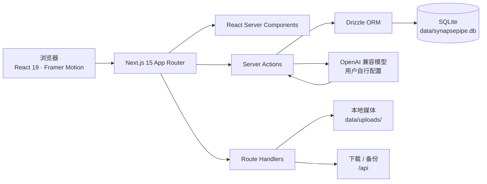

<p align="center">
  
</p>

<h1 align="center">SynapsePipe</h1>

<p align="center">
  <strong>Next-gen Local-first AIGC Workbench &amp; Creative Pipeline</strong><br/>
  <sub>本地优先的 AIGC 创意工作台与资产管理管线</sub>
</p>

<p align="center">
  <a href="https://nextjs.org/"></a>
  <a href="https://react.dev/"></a>
  <a href="https://www.typescriptlang.org/"></a>
  <a href="https://tailwindcss.com/"></a>
  <a href="https://orm.drizzle.team/"></a>
  <a href="./LICENSE"></a>
</p>

<p align="center">
  <a href="./README.md">English</a> ·
  <a href="#-快速开始">快速开始</a> ·
  <a href="#-架构">架构</a> ·
  <a href="#-功能">功能</a> ·
  <a href="#-docker">Docker</a>
</p>

---


## 为什么是 SynapsePipe？

大多数 AIGC 工作流是断裂的：Prompt 留在聊天记录里，Seed 留在截图里，成片留在下载文件夹里。SynapsePipe 用一个本地优先的工作台把这条链路接起来：

- **结构化沉淀**：Prompt 不只是一段文本，还包含中英双语、风格、镜头语言、目标模型、画幅比例、负向词、可复用 `[变量]` 与导演阐述。
- **可复现的资产**：每件资产记录 Prompt 快照、Seed、模型、生成参数、分类与标签，让“重新出片”变成有据可依的操作。
- **数据属于你**：SQLite 与上传媒体都在 `data/`，API Key 使用 AES-256-GCM 加密。无账号、无遥测、无云端后端。
- **克制的速度感**：Server Components + Server Actions、乐观交互、防抖搜索、精确骨架屏、媒体模糊占位与 Framer Motion 微动效。

## 功能

<table>
  <tr>
    <td width="50%" valign="top">
      <h3>◈ 结构化 Prompt 创意库</h3>
      <p>列表 / 看板双视图，按风格、模型、镜头语言、工作流阶段、收藏与标签筛选。支持中英双语、一键复制、变量填充（如 <code>[主体] in [场景]</code>）。</p>
    </td>
    <td width="50%" valign="top">
      <h3>✦ AI Prompt 魔法扩写台</h3>
      <p>一句话灵感 → 大师级中英双语 Prompt + 负向词 + 分镜参数 + 变量 + 导演建议。兼容 DeepSeek、OpenAI、OpenRouter、Ollama、LM Studio 等 OpenAI 格式服务。</p>
    </td>
  </tr>
  <tr>
    <td width="50%" valign="top">
      <h3>▣ 可追溯资产画廊</h3>
      <p>支持本地图片 / 视频上传与外部 URL 引用。每件资产关联 Prompt 快照、Seed、模型与参数；支持收藏、分类筛选、详情预览、下载导出与一键复制生成配方。</p>
    </td>
    <td width="50%" valign="top">
      <h3>⌘ 高级 SaaS 级界面</h3>
      <p>深色优先的中性色系统、微边框、磨砂玻璃、紧凑排版、命令面板、深浅主题、响应式导航与 Sonner 轻提示。所有加载态都有对齐的骨架屏。</p>
    </td>
  </tr>
  <tr>
    <td width="50%" valign="top">
      <h3>⛁ 数据路径完全可控</h3>
      <p><code>data/synapsepipe.db</code> 单文件存储，媒体位于 <code>data/uploads/</code>，加密盐位于 <code>data/.secret</code>。复制整个文件夹即可完整备份，也可在设置中导出元数据 JSON。</p>
    </td>
    <td width="50%" valign="top">
      <h3>⬡ 单进程，零额外服务</h3>
      <p>后端逻辑全部通过 Next.js Server Actions 与 Route Handlers 完成，不需要独立 Python / Go / Express 服务。附带多阶段构建 Docker 镜像。</p>
    </td>
  </tr>
</table>

## 界面预览

| Prompt 库 | AI 扩写台 |
| --- | --- |
|  |  |

| 资产画廊 | 设置 |
| --- | --- |
|  |  |

| 命令面板 | 看板视图 |
| --- | --- |
|  |  |

<p align="center">
  
  
</p>

## 快速开始

**环境要求**：Node.js **20.11+**（推荐 22 LTS）、npm 10+。

```bash
git clone https://github.com/FanDuck/SynapsePipe.git
cd SynapsePipe
npm install
cp .env.example .env.local   # 可选：所有变量都有本地默认值
npm run dev
```

打开 **http://localhost:3000**。

首次启动会自动创建 `data/synapsepipe.db`、初始化表结构并写入演示内容（9 条 Prompt + 8 件离线演示资产）。删除 `data/` 即可重置；设置 `SYNAPSE_DISABLE_DEMO_SEED=1` 可跳过演示数据。

### 连接模型服务

1. 进入 **设置 → 模型服务**；
2. 选择预设，或填入任意兼容 OpenAI 的 **Base URL** 与 **模型名称**；
3. 填入 **API Key**（本地 Ollama / LM Studio 可留空），点击 **保存设置**；
4. 点击 **测试连接**，然后去 **AI 扩写台** 把灵感编译成 Prompt。

| 服务 | Base URL | 模型示例 |
| --- | --- | --- |
| DeepSeek | `https://api.deepseek.com/v1` | `deepseek-chat` |
| OpenAI | `https://api.openai.com/v1` | `gpt-4.1-mini` |
| OpenRouter | `https://openrouter.ai/api/v1` | `openai/gpt-4.1-mini` |
| SiliconFlow | `https://api.siliconflow.cn/v1` | `deepseek-ai/DeepSeek-V3` |
| Ollama | `http://localhost:11434/v1` | `qwen2.5:7b` |
| LM Studio | `http://localhost:1234/v1` | 当前加载的模型 |

> 请求会发往 `/chat/completions`。支持 JSON mode 时自动启用，不支持时自动降级重试。

## Docker

```bash
docker compose up -d
# → http://localhost:3000
```

常用命令：

```bash
docker compose logs -f
docker compose down            # 保留数据
docker compose down -v         # 删除数据卷（危险）
```

可在 `docker-compose.yml` 同级 `.env` 中覆盖端口、加密盐与演示数据开关。SQLite 与上传媒体持久化在 `synapsepipe_data` 数据卷中。

## 架构



只有一个 Next.js 进程：浏览器与 App Router 通信，服务端负责 SQLite、文件存储、密钥加密与模型调用。

### 数据模型

| 表 | 用途 | 关键字段 |
| --- | --- | --- |
| `prompts` | 结构化创意配方 | `prompt_zh`、`prompt_en`、`negative_prompt`、`style`、`camera`、`model`、`aspect_ratio`、`stage`、`tags[]`、`variables[]`、`shot_params`、`is_favorite`、`usage_count` |
| `assets` | 生成 / 引用媒体 | `type`、`source`、`url`、`storage_key`、`prompt_id → prompts`、`prompt_snapshot`、`seed`、`model`、`category`、`tags[]`、`params`、`is_favorite` |
| `settings` | 单行本地配置 | `llm_base_url`、`llm_api_key_cipher`、`llm_model`、`default_negative_prompt`、`default_language` |

Drizzle Schema 位于 [`src/lib/db/schema.ts`](./src/lib/db/schema.ts)，启动时幂等建表与填充演示数据位于 [`src/lib/db/index.ts`](./src/lib/db/index.ts)。

## 环境变量

| 变量 | 默认值 | 说明 |
| --- | --- | --- |
| `SYNAPSE_DATA_DIR` | `./data` | SQLite 与上传媒体的数据根目录 |
| `SYNAPSE_DB_PATH` | `<data>/synapsepipe.db` | 可选，Drizzle CLI 使用的数据库路径 |
| `SYNAPSE_SECRET` | 自动生成 | 用于加密 API Key；省略时写入 `data/.secret` |
| `SYNAPSE_LLM_BASE_URL` | `https://api.deepseek.com/v1` | 首次启动的模型服务地址 |
| `SYNAPSE_LLM_API_KEY` | 空 | 首次启动的 API Key（立即加密） |
| `SYNAPSE_LLM_MODEL` | `deepseek-chat` | 首次启动的模型名称 |
| `SYNAPSE_DISABLE_DEMO_SEED` | `0` | 设为 `1` 跳过演示内容 |
| `NEXT_PUBLIC_APP_URL` | `http://localhost:3000` | Metadata / Open Graph 基础地址 |

## 常用命令

| 命令 | 说明 |
| --- | --- |
| `npm run dev` | Turbopack 开发服务器 |
| `npm run build` | 生产构建（standalone） |
| `npm run start` | 启动生产服务器 |
| `npm run lint` | ESLint |
| `npm run typecheck` | `tsc --noEmit` |
| `npm run db:generate` | 从 Drizzle Schema 生成迁移 |
| `npm run db:studio` | 启动 Drizzle Studio |

## 安全与隐私

- 无账号、无遥测、无云同步，默认面向 `localhost` 单机使用。
- API Key 使用 **AES-256-GCM** 加密，密钥来自 `SYNAPSE_SECRET` 或自动生成的 `data/.secret`；仅在向模型服务发起请求时于服务端解密。
- 上传文件校验 MIME 与扩展名（最大 30MB），存放在非公开目录并通过受控路由读取。
- **没有内置登录鉴权。** 不要把 SynapsePipe 直接暴露到公网；如需外网访问，请放在带认证的反向代理之后，或仅限可信局域网 / VPN。
- 完整备份请复制 `data/` 目录。丢失 `data/.secret` 后需要重新填写 API Key。

安全问题请参阅 [SECURITY.md](./SECURITY.md)。

## 路线图

- [x] Prompt 库 + 列表 / 看板双视图
- [x] 中英双语、变量占位符与一键复制
- [x] OpenAI 兼容 AI 扩写 + 加密配置
- [x] 本地 / URL 资产画廊 + Prompt / Seed 溯源
- [x] 深浅主题、命令面板、响应式 App Shell
- [x] Docker 镜像、Compose、JSON 元数据备份
- [ ] 可拖拽看板与键盘无障碍移动
- [ ] Prompt 版本历史与 Diff 视图
- [ ] 包含媒体的完整 ZIP 备份
- [ ] 视频缩略图与时间线预览
- [ ] 可选的多用户鉴权适配
- [ ] 从 JSON 备份导入
- [ ] 英文 UI 与语言切换

## 参与贡献

欢迎 Issue、想法与 PR。开始前请阅读 [CONTRIBUTING.md](./CONTRIBUTING.md)。提交 PR 前请至少运行：

```bash
npm run lint
npm run typecheck
npm run build
```

提交信息遵循 [Conventional Commits](https://www.conventionalcommits.org/)，例如 `feat:`, `fix:`, `style:`, `docs:`, `chore:`。项目遵循 [Contributor Covenant](./CODE_OF_CONDUCT.md)。

## 许可证

[MIT](./LICENSE) © 2026 SynapsePipe contributors。

`public/demo/` 内的演示视觉资产为本仓库专门创作。文中出现的模型与服务名称归各自所有者所有，SynapsePipe 与它们没有隶属关系。

---

<p align="center">
  <sub>如果 SynapsePipe 让你的创作管线更清晰一点，欢迎点一个 Star。</sub>
</p>
